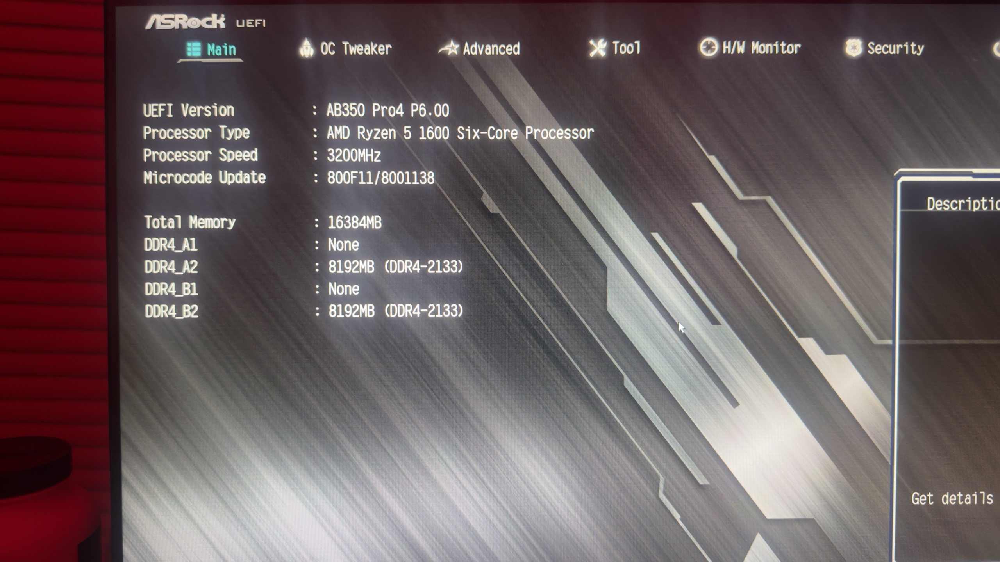
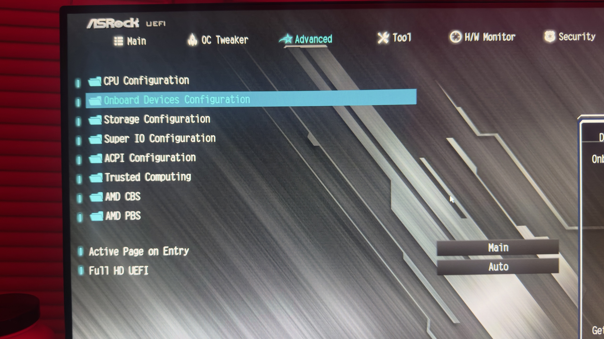
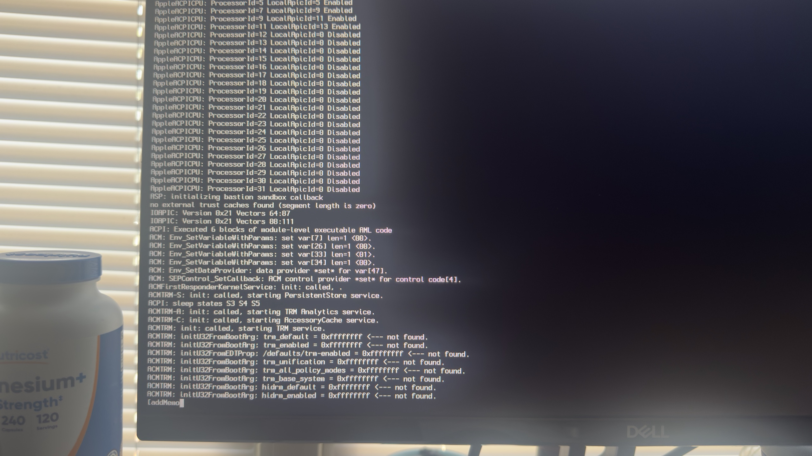
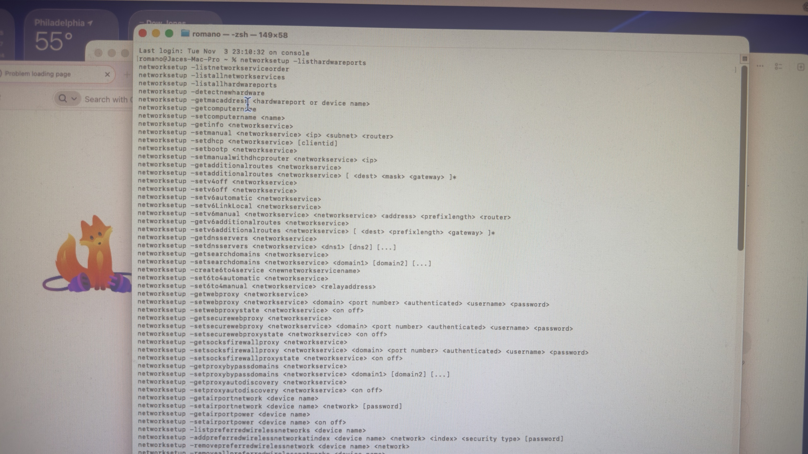

# macOS Systems Lab

My notes on learning to inspect software on an Intel Mac. Working with the 1401 (NullMoth) 2.7.2 package taught me to break “will this run on my machine?” into smaller questions: What did I download? What does the package expect? What can I verify before running it?

## A case study: reading a Mac app bundle

On macOS 15.8.2 (x86_64), using zsh, I looked at the difference between a downloaded ZIP, the extracted .app, and the executable inside it. The bundle has a launcher under `Contents/MacOS`, metadata in `Info.plist`, and JavaScript, CSS, shell scripts, and hardware rule files under `Contents/Resources`. That layout gave me a practical way to navigate an unfamiliar release.

| Skill | Example from the package | What I learned |
| --- | --- | --- |
| Inspecting a release | The launcher and setup script are separate files. | I can locate the entry point and inspect setup steps before deciding to run them. |
| Reasoning about compatibility | GPU mapping, Metal device discovery, and runtime checks have distinct helpers. | A hardware identifier, an available graphics API, and a working runtime answer different questions. |
| Planning diagnostics | The package includes preflight checks, log capture, and an uninstaller. | I can plan what evidence to collect before a change and identify the proposed recovery path. |

## Run the inspection

From the repository directory, run [inspect-macos.sh](./inspect-macos.sh) with the path to your extracted copy of the app. Replace the example path with yours and keep the quotes if it contains spaces.

```sh
sh inspect-macos.sh "/path/to/1401.app"
```

The script prints its findings to the terminal without launching the app. If the app is named `1401.app` and sits in the repository directory, you can simply run `sh inspect-macos.sh`.

## Results on my Mac

| Check | Observed result |
| --- | --- |
| Host | macOS 15.8.2 on Intel (`x86_64`) |
| App version | 1401 version 2.7.2, build 140 |
| Minimum macOS declared by the app | 15.0 |
| Launcher format reported by `file` | `Mach-O 64-bit executable x86_64` |

My Mac meets the app’s declared minimum OS version, and the launcher architecture matches my Mac’s CPU. These checks cover the bundle on disk. Testing the driver would require a separate runtime check.

## Commands behind the script

From the directory containing the extracted app, these read-only commands report the host version, CPU architecture, package metadata, and launcher format:

```zsh
sw_vers -productVersion
uname -m
plutil -p "1401.app/Contents/Info.plist"
file "1401.app/Contents/MacOS/1401"
```

My working configuration pairs a zsh shell for local inspection with Codex and task-specific plugins for assisted work. I keep downloaded software separate from notes I intend to publish. This repository shares the inspection method and reviewed project photographs; it contains no vendor binaries, raw machine log files, or private configuration. The app-bundle case study covers package inspection only; hardware support and runtime behavior would need separate tests.

## Real-world hardware and diagnostic examples

Photographs from my macOS systems integration and troubleshooting work, documenting hardware identification, UEFI navigation, verbose boot diagnostics, and command-line investigation.

### Hardware identification

The ASRock UEFI overview identifies an AB350 Pro4 motherboard, AMD Ryzen 5 1600 processor, and 16 GB of installed memory. This records the hardware context for compatibility research.



### UEFI configuration navigation

The Advanced menu provides access to onboard devices, storage, ACPI, and AMD configuration options used during firmware investigation.



### Verbose boot diagnostics

An intermediate macOS startup screen shows processor initialization, ACPI messages, and other boot output examined while investigating initialization behavior.



### Command-line network investigation

The macOS terminal displays `networksetup` command help while exploring hardware-port and network-service diagnostics. Arguments such as `<ip>` and `<password>` are usage placeholders. The photograph documents command discovery; it does not establish that network connectivity was restored.



The published copies are resized for web viewing and have GPS, capture-time, camera, EXIF, and XMP metadata removed. No screen text has been added or edited.
